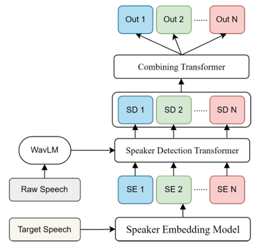

# TS-VAD+ : A Transformer-based Approach for Speaker Diarization

## Model Summary

TS-VAD+ is a transformer-based speaker diarization system designed to detect "who spoke when" in multi-speaker audio. It processes two inputs: (1) raw speech, encoded using a WavLM model into frame-level acoustic features, and (2) speaker profiles, extracted from single-speaker audio segments using ECAPA-TDNN embeddings. These inputs are passed through a two-stage transformer architecture—first to perform independent speaker activity detection for each speaker, and then to integrate outputs into a unified probability stream. The final predictions are postprocessed to generate RTTM files. Compared to traditional clustering-based pipelines and EEND models, TS-VAD+ is more robust in overlapping speech scenarios and requires less training data.

<p align="center">
  
</p>

<p align="center"><em>Figure: TS-VAD+ model architecture</em></p>


## Improvements Over Baseline TS-VAD

This repository presents TS-VAD+, a significant enhancement over the original TS-VAD diarization model. The following upgrades were implemented:

- **ECAPA-TDNN Speaker Embeddings**: Replaced traditional i-vectors with ECAPA-TDNN to improve speaker representation and robustness in noisy and overlapping speech.
- **WavLM-based Feature Extraction**: Integrated a WavLM encoder, pre-trained on noisy and multi-speaker scenarios, for more discriminative acoustic features.
- **Wideband Simulated Pretraining**: Developed a 16kHz simulated dataset from LibriSpeech for better domain adaptation to DIHARD III data.
- **Improved Clustering**: Used VBx instead of x-vector clustering, reducing DER significantly before model input.
- **Memory-Aware Attention (mm-TS-VAD+)**: Introduced a memory module that dynamically refines speaker embeddings using external cluster centroids.
- **Data Augmentation**: Mixed single- and two-speaker DIHARD III recordings to generate new, realistic overlapping speech conditions.
- **VAD Postprocessing**: Applied pyannote’s VAD to further clean false alarms and reduce overall DER.

## Results Summary on DIHARD III (Track 2)

| Model                         | DER (%) |
|-------------------------------|---------|
| VBx-HMM with OSD              | 21.97   |
| EEND                          | 20.05   |
| mm-TS-VAD+ with Augmentation  | 22.36   |
| TS-VAD+ (our best model)      | 19.11   |
| SOTA (ANSD-MA-MSE)            | 16.76   |

The best TS-VAD+ configuration (ECAPA-TDNN + WavLM + VBx + VAD) achieves a DER of **19.11%** improving upon intial result of **22.57%** and surpassing other models such as VBx-HMM and EEND, particularly in high-overlap scenarios such as meetings and restaurants.

---
## Requirements

- An NVIDIA GPU with CUDA (training and evaluation call `.cuda()` throughout; CPU is not supported). The original runs used 1 GPU, 16 CPU cores, ~128–189 GB RAM, and up to 24 h per training job.
- Linux with `sox` and `perl` installed (`sudo apt-get install sox perl`).
- Conda.

## Installation

```bash
git clone <your-repo-url> TS-VAD-plus
cd TS-VAD-plus
conda env create --name tsvad --file=tsvad.yml     # Python 3.8, torch 2.0.1, CUDA 11.7
conda activate tsvad
pip install sox                                    # only needed for convert.py
cd ts-vad && unzip tools.zip && cd ..              # creates ts-vad/tools/ (helpers + md-eval scorer) — required
```

### Pre-trained models

```bash
mkdir -p ts-vad/pretrained_models
```

- [WavLM-Base+.pt](https://drive.google.com/file/d/1-zlAj2SyVJVsbhifwpTlAfrgc9qu-HDb/view?usp=share_link) → `ts-vad/pretrained_models/WavLM-Base+.pt` (default for `--speech_encoder_pretrain`)
- [ecapa-tdnn.model](https://drive.google.com/file/d/1E-ju12Jy1fID2l4x-nj0zB5XUHSKWsRB/view?usp=drive_link) → `ts-vad/pretrained_models/ecapa-tdnn.model` (default for `--source` in data preparation)
- Augmentation data: [MUSAN](https://www.openslr.org/17/) and [RIRS_NOISES](https://www.openslr.org/28/).

The speaker-encoder type is chosen from the checkpoint file name: `ecapa*` → ECAPA-TDNN (default), `campplus*` → CAM++, `eres2net*` → ERes2Net. CAM++ / ERes2Net additionally need their model code (`Cam_plusplus/`, `eres2net/`, from 3D-Speaker) on the Python path; it is not included in this repo.

## Prepare DIHARD3

### 1. Download

```bash
pip install gdown
gdown --folder 1S3RqdbUszN1nRjUAmtm_PvrBDtnXn65Z
```

```
DIHARD3
├── third_dihard_challenge_dev/data/{flac,rttm,sad,uem,uem_scoring}
└── third_dihard_challenge_eval/data/{flac,rttm,sad,uem,uem_scoring}
```

### 2. Convert FLAC → WAV (with 8 kHz round-trip)

The simulated pre-training data is 8 kHz up-sampled to 16 kHz. Down-sampling DIHARD3 to 8 kHz and back to 16 kHz to match it improves TS-VAD results noticeably. `convert.py` does the conversion (and, with `--resample-8k`, the round-trip) in one step:

```bash
for SPLIT in dev eval; do
  D=DIHARD3/third_dihard_challenge_$SPLIT/data
  python convert.py $D/flac $D/wav --resample-8k
done
```

### 3. Put the right RTTMs in place

This is the step that decides what TS-VAD is evaluated on:

| Folder | Contents |
|---|---|
| `third_dihard_challenge_dev/data/rttm/*.rttm` | **Ground truth** (training labels and speaker profiles) |
| `third_dihard_challenge_eval/data/rttm/*.rttm` | **Your clustering output** (e.g. VBx), one file per recording. Speaker profiles for evaluation are extracted from these. |
| `third_dihard_challenge_eval/data/rttm/all.rttm` | **Ground truth**, all eval recordings concatenated. Used only for DER scoring (`--ref_rttm`); data preparation skips it. |

Save the ground-truth eval RTTMs **before** replacing them with clustering output:

```bash
cat DIHARD3/third_dihard_challenge_eval/data/rttm/*.rttm > all.rttm.gt
# ... replace eval/data/rttm/DH_EVAL_*.rttm with your clustering RTTMs ...
mv all.rttm.gt DIHARD3/third_dihard_challenge_eval/data/rttm/all.rttm
```

Speaker labels may be `speakerX` (DIHARD ground truth) or bare labels such as `1` / `spk01` (VBx). For a quick sanity check you can leave the ground-truth RTTMs in the eval folder too ("oracle" speaker profiles); expect a much lower DER than with clustering output.

### 4. Extract target audio and speaker embeddings

```bash
cd ts-vad/prepare
DIHARD_ROOT=/abs/path/to/DIHARD3 MAX_SPEAKER=8 ./prepare_dihard.sh          # dev (+ train/val split) and eval
# or on a PBS cluster:  qsub -v DIHARD_ROOT=/abs/path/to/DIHARD3 prepare_job.pbs
```

This creates, for each split:

```
third_dihard_challenge_{dev,eval}/data
├── wav/DH_*.wav
├── rttm/DH_*.rttm   (+ all.rttm for eval)
├── target_audio/DH_*/{1.wav, 2.wav, ..., all.wav}     # single-speaker audio per speaker + full mix
├── target_embedding/DH_*/{1.pt, 2.pt, ...}            # ECAPA-TDNN embeddings, 6 s window / 1 s step
└── ts_{dev,eval}.json                                  # 40 ms frame labels per speaker

third_dihard_challenge_dev/data  (written by split_dev.py)
├── ts_train.json, ts_val.json                          # dev recordings split ~80/20, stratified by domain
├── val_recordings.txt                                  # validation recordings + domain
└── val_all.rttm                                        # ground truth of the validation recordings
```

Notes:
- At most `--max_speaker` speakers (the ones who talk most) are kept per recording. Use the same value for preparation and training.
- **Speaker profiles for speakers with little speech.** A speaker's profile is built from their non-overlapped speech when there is at least `MIN_CLEAN_DUR` (2 s) of it. Otherwise it is built from all of their speech, overlap included. Only speakers with less than `MIN_SPEAKER_DUR` (0.5 s) are dropped. Profiles shorter than the 6 s embedding window get a single embedding over the whole clip. The original code dropped every speaker with less than 6 s of clean speech, so their speech was always missed. The script prints how many speakers were kept or dropped and how much speech the dropped ones had. `MIN_CLEAN_DUR=6 MIN_SPEAKER_DUR=6` plus `--overlap_fallback false` roughly restores the old behaviour.
- **Validation split.** `split_dev.py` (run automatically after dev) holds out about 20% of the dev recordings (`VAL_FRAC`, `SEED`), stratified by the domains in `data/uem_scoring/full/*.uem`. Training uses `ts_train.json`; epochs, checkpoint averaging and post-processing are chosen on `ts_val.json`. The eval set is scored once at the end.

## Quick local test (CPU, small subset)

Before using the cluster, you can check the whole pipeline on a laptop. Without a GPU the code runs on CPU automatically, and MUSAN/RIRs are optional (missing augmentation types are skipped).

```bash
cd ts-vad
# 1. copy 5 dev + 5 eval recordings (wav + rttm + uem_scoring) into a mini tree; eval rttms = ground truth (oracle)
./prepare/make_mini_dihard.sh /abs/path/DIHARD3 /abs/path/DIHARD3_mini 5
# 2. targets + ECAPA embeddings + train/val split (use the same MAX_SPEAKER as the smoke run)
DIHARD_ROOT=/abs/path/DIHARD3_mini MAX_SPEAKER=4 ./prepare/prepare_dihard.sh
# 3. the real pipeline with tiny settings: train 2 epochs (WavLM frozen, batch 2) -> average -> tune on val -> eval
DIHARD_ROOT=/abs/path/DIHARD3_mini ./run_smoke.sh
```

Outputs go to `ts-vad/exps/smoke/` (training) and `ts-vad/exps/smoke/final/` (validation, tuned post-processing, eval). Expect the loss to fall slightly and DER to stay high. This run checks that the code works, not model quality. On synthetic data it takes about 2 minutes and 1.5 GB of RAM.

## Training on DIHARD3

All run scripts read their paths from environment variables (or edit the defaults at the top of each script):

```bash
cd ts-vad
DIHARD_ROOT=/abs/path/to/DIHARD3 \
MUSAN=/abs/path/to/musan \
RIRS=/abs/path/to/RIRS_NOISES/simulated_rirs \
SAVE_PATH=exps/dihard3_ecapa_8spk \
./run_train.sh
```

On a cluster:

```bash
# PBS
qsub  -v DIHARD_ROOT=...,MUSAN=...,RIRS=...,SAVE_PATH=... job.pbs
# Slurm
sbatch --export=ALL,DIHARD_ROOT=...,MUSAN=...,RIRS=...,SAVE_PATH=... job.slurm
```

Training uses `ts_train.json` and validates on the held-out dev recordings (`ts_val.json`, `val_all.rttm`) after every epoch (`EVAL_EPOCHS=all`). The eval set is not touched. The checkpoint with the lowest validation DER (collar 0) is copied to `SAVE_PATH/model/best.model` (score in `SAVE_PATH/best.json`). Hyperparameters can be overridden from the environment: `BATCH_SIZE`, `MAX_EPOCH`, `WARM_UP_EPOCH`, `LR`, `LR_DECAY`, `N_CPU`, `SPEECH_ENCODER`.

Adjust the queue / resource lines (`#PBS -q`, `#SBATCH --gres`, memory) to your cluster. If the job is restarted, training resumes automatically from the latest `SAVE_PATH/model/model_XXXX.model`. This also applies when fine-tuning with `INIT_MODEL`: existing checkpoints in `SAVE_PATH` take priority. So use a fresh `SAVE_PATH` for each new experiment.

The equivalent direct command:

```bash
python main.py \
  --train_list $DEV/ts_train.json --train_path $DEV \
  --eval_list  $DEV/ts_val.json   --eval_path  $DEV \
  --ref_rttm   $DEV/val_all.rttm  --uem_dir $DEV/uem_scoring/full \
  --musan_path $MUSAN --rir_path $RIRS \
  --save_path  exps/dihard3_ecapa_8spk \
  --max_speaker 8 --warm_up_epoch 5 --batch_size 40 --rs_len 4 --test_shift 4 \
  --lr 0.0001 --lr_decay 0.95 --test_step 1 --max_epoch 60 --eval_epochs all --train
```

Key options:

| Option | Default | Meaning |
|---|---|---|
| `--max_speaker` | 8 | Speaker slots per chunk; must match data preparation |
| `--warm_up_epoch` | 10 | WavLM is frozen for epochs before this |
| `--rs_len` | 16 | Chunk length in seconds (scripts use 4) |
| `--eval_epochs` | `12,18,30,...` (scripts: `all`) | Epochs at which the eval list (validation in the scripts) is scored, or `all` |
| `--ref_rttm` | `<eval_path>/rttm/all.rttm` | Ground-truth RTTM for DER; scoring is skipped if missing |
| `--uem_dir` | – | Folder of `<domain>.uem` files; adds a per-domain DER table |
| `--threshold`, `--median_kernel`, `--min_silence`, `--min_speech` | 0.5, 21, 0.32, 0 | Post-processing (see Evaluation) |
| `--postproc_json` | – | Load the four post-processing settings from `tune_postproc.py` output |
| `--init_model` | – | Start from a checkpoint (fine-tuning) |
| `--legacy_head` | false | Use the old output head; only for checkpoints trained before the head fix (see below) |

### Outputs

```
SAVE_PATH/
├── model/model_0001.model ...   # one checkpoint per epoch
├── model/best.model             # lowest validation DER so far (best.json has epoch + DER)
├── score.txt                    # "Train: N epoch, LR, LOSS", "Eval full 0.25 / 0.00: DER, MS, FA, SC", per-domain tables
├── probs.npz                    # per-frame speaker probabilities of the latest evaluation
└── res_rttm                     # RTTM of the latest evaluation
```

DER is reported at collar 0.25 s and at **collar 0.00 s (the DIHARD3 metric)**. MS = missed speech, FA = false alarm, SC = speaker confusion.

## Pre-training on simulated data

Starting layout:

```
SIMU3
├── data/{swb_sre_cv_ns1_beta2_200, ..., swb_sre_tr_ns6_beta20_1000}
└── wav/{swb_sre_cv_ns1_beta2_200, ..., swb_sre_tr_ns6_beta20_1000}
```

Run in this order (from `ts-vad/prepare/`):

```bash
cd ts-vad/prepare/simulated_data_prep_utils
python 1-make_rttm_folders.py   /abs/path/SIMU3/data
python 2-copy_wav.py            /abs/path/SIMU3
cd .. && SIM_DATA=/abs/path/SIMU3/data ./prepare_simulated.sh     # edit the folder list inside if needed
cd simulated_data_prep_utils
python 3.2-move_to_all_files.py /abs/path/SIMU3/data
python 4-move_jsons.py          /abs/path/SIMU3/data
```

Result:

```
SIMU3/data/all_files
├── rttms/            (7200 files)
├── target_audio/     (7200 dirs: <spk>.wav + all.wav)
├── target_embedding/ (7200 dirs: <spk>.pt)
└── all_simtrain.json
```

Train:

```bash
cd ts-vad
SIM_ROOT=/abs/path/SIMU3/data/all_files DIHARD_ROOT=... MUSAN=... RIRS=... ./run_train_sim.sh
```

`--simtrain` (or `--simtrain true`) enables simulated-data mode.

### Fine-tuning on DIHARD3

```bash
INIT_MODEL=exps/simtrain_ecapa_8spk/model/model_0040.model \
SAVE_PATH=exps/dihard3_finetune DIHARD_ROOT=... MUSAN=... RIRS=... ./run_train.sh
```

## Evaluation

### Final result (use this for reported numbers)

```bash
cd ts-vad
DIHARD_ROOT=/abs/path/to/DIHARD3 TRAIN_DIR=exps/dihard3_ecapa_8spk ./run_final.sh
```

`run_final.sh` keeps every choice on validation data:

1. **Checkpoint averaging:** averages the weights of the `AVG_N` (5) epochs with the lowest validation DER (`average_checkpoints.py`). Set `MODEL=...` to use one checkpoint instead.
2. **Validation inference** with a 0.5 s shift (overlapping windows are averaged); saves `probs.npz`.
3. **Post-processing tuning** on validation only (`tune_postproc.py`): a grid over threshold, median-filter length, `min_silence` and `min_speech` (336 settings, run in parallel), with the best written to `postproc.json`.
4. **Eval set, scored once** with those settings: overall DER at collars 0.25 / 0, plus a per-domain table.

```
TRAIN_DIR/final/
├── avg_best5.model
├── val/   score.txt, probs.npz, res_rttm
├── postproc.json                # chosen settings + the full grid
└── test/  score.txt, probs.npz, res_rttm    # the number to report
```

Re-tune without re-running the model: `python tune_postproc.py --probs <val>/probs.npz --ref <dev>/val_all.rttm --out postproc.json`.

### Quick check of one checkpoint

```bash
DIHARD_ROOT=/abs/path/to/DIHARD3 MODEL=exps/dihard3_ecapa_8spk/model/best.model SAVE_PATH=exps/eval_best ./run_eval.sh
```

This uses the default post-processing (or `POSTPROC_JSON=...`) and writes `SAVE_PATH/res_rttm`. Any RTTM can be scored with `python scoring_utils.py --ref <ref.rttm> --sys <sys.rttm> [--uem_dir <data>/uem_scoring/full]`.

### RTTM timing fix

Frame *i* covers [0.04·i, 0.04·(i+1)) s. The original RTTM writer stored each segment's start as the index of the silent frame before it, so every segment (except one starting at 0 s) was written 40 ms early. Shifting the bundled `scoring/res.rttm` by 40 ms lowers its DER from 24.40% to **23.84%** at collar 0 (11.65% → 11.61% at collar 0.25) with no retraining. New RTTMs are written correctly.

### Official-style scoring (per domain, CORE set)

`main.py` scores against the full eval set with md-eval and no UEM. For DIHARD3 CORE-set numbers per domain:

```bash
cd scoring
DIHARD_EVAL_DIR=/abs/path/to/DIHARD3/third_dihard_challenge_eval \
./score.sh ../ts-vad/exps/eval_e30/res_rttm /abs/path/to/DIHARD3/third_dihard_challenge_eval/data/rttm/all.rttm
```

Per-domain results are written to `scoring/individual_scores/`.

### What to expect

- Example: the RTTM bundled in `scoring/res.rttm` scores **DER 24.40%** at collar 0 (MS 13.12%, FA 7.62%, SC 3.65%) and 11.65% at collar 0.25 against `scoring/all_rttm` (md-eval, full set, no UEM). With the 40 ms timing fix: 23.84%.
- The best configuration in the Results Summary above reached 19.11%.
- With VBx RTTMs as speaker input, DER at collar 0 should be roughly in the 19–25% range. With oracle (ground-truth) speaker profiles it should be clearly lower.
- Most of the remaining error is missed speech, not speaker confusion.

## Output head fix (changes vs. earlier versions)

Earlier versions turned the multi-speaker transformer output `(B, T, 384)` into per-speaker outputs with a raw `reshape((B, max_speaker, T, -1))`. That reshape mixes the time and speaker axes: speaker *i*'s prediction at frame *t* was computed from backend frame ≈ (i·T + t) / max_speaker, so each speaker only "saw" one slice of the chunk. The output layer was also hard-coded to `Linear(192, 1)`, which crashes for any `--max_speaker` other than 2.

The head is now a per-frame `Linear(384, max_speaker)`: frame *t* of every speaker comes from backend frame *t*.

- **New training** uses the fixed head automatically.
- **Old checkpoints** (including those behind the results above) can still be evaluated with `--legacy_head true` (`LEGACY_HEAD=true ./run_eval.sh`).
- **Fine-tuning an old checkpoint** without `--legacy_head` loads everything except the output layer, which is trained from scratch (a warning is printed).

The results table was produced with the old head. Re-train to measure the effect of the fix.

## Notes

- Speaker embeddings come from an ECAPA-TDNN trained on CnCeleb1+2 and the AliMeeting training set.
- If scripts are not executable after cloning: `chmod +x ts-vad/*.sh ts-vad/prepare/*.sh scoring/*.sh scoring/utils/*.py scoring/utils/parse_options.sh`.
- Epochs and thresholds in the Results Summary were selected on the DIHARD3 eval set. The current scripts select them on a held-out dev split instead (`run_train.sh` + `run_final.sh`), so new numbers are not directly comparable with that table.
- The validation speaker profiles come from ground-truth dev RTTMs (oracle), while eval profiles come from clustering output. Validation DER is therefore lower than eval DER, and post-processing tuned on validation may not be exactly optimal for eval. To match eval conditions, run your clustering (e.g. VBx) on the validation recordings and prepare them as a separate split: put `wav/` and the clustering RTTMs in `third_dihard_challenge_devval/data/` and run `TYPES=devval ./prepare/prepare_dihard.sh`. Then point validation at that folder (`--eval_path`, `--eval_list .../ts_devval.json`), keeping `val_all.rttm` as the reference.
- `model/selective_scan_interface.py` (Mamba) and `prepare/prepare_dihard_old.py` are not used by the default pipeline.

## References

[1] Yusuke Fujita et al., *End-to-End Neural Speaker Diarization with Permutation-Free Objectives*, Interspeech 2019.
[2] Medennikov, Ilia et al., *Target-speaker voice activity detection: A novel approach for multi-speaker diarization in a meeting scenario*, ICASSP 2020.
[3] Landini, Federico et al., *Bayesian HMM clustering of x-vector sequences (VBx) for speaker diarization*, Interspeech 2020.
[4] Yu Hou, Tianyu Zhao, Xinyu Zhang et al., *ANSD-MA-MSE: Memory-Aware Multi-Speaker Embedding for Neural Speaker Diarization*, ICASSP 2024.
